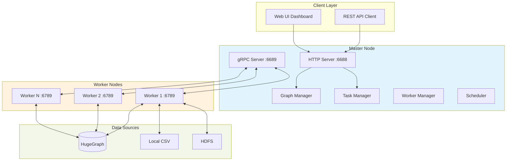

# Vermeer - High-Performance In-Memory Graph Computing

[](https://deepwiki.com/apache/hugegraph-computer)

Vermeer is a high-performance in-memory graph computing platform with a single-binary deployment model. It provides 20+ graph algorithms, custom algorithm extensions, and seamless integration with HugeGraph.

## Key Features

- **Single Binary Deployment**: Zero external dependencies, run anywhere
- **In-Memory Performance**: Optimized for fast iteration on medium to large graphs
- **Master-Worker Architecture**: Horizontal scalability by adding worker nodes
- **REST API + gRPC**: Easy integration with existing systems
- **Web UI Dashboard**: Built-in monitoring and job management
- **Multi-Source Support**: HugeGraph, local CSV, HDFS
- **20+ Graph Algorithms**: Production-ready implementations

## Architecture



### Directory Structure

```
vermeer/
├── main.go              # Single binary entry point
├── Makefile             # Build automation
├── algorithms/          # 20+ algorithm implementations
│   ├── pagerank.go
│   ├── louvain.go
│   ├── sssp.go
│   └── ...
├── apps/
│   ├── master/          # Master service
│   │   ├── services/    # HTTP handlers
│   │   ├── workers/     # Worker management
|   |   ├── schedules/    # Task scheduling strategies
│   │   └── tasks/       # Task scheduling
│   ├── compute/         # Worker-side compute logic
│   ├── graphio/         # Graph I/O (HugeGraph, CSV, HDFS)
│   │   └── hugegraph.go # HugeGraph integration
│   ├── protos/          # gRPC definitions
│   └── common/          # Utilities, logging, metrics
├── config/              # Configuration templates
│   ├── master.ini
│   └── worker.ini
├── tools/               # Binary dependencies (supervisord, protoc)
└── ui/                  # Web dashboard source and dependencies
    ├── package.json     # Frontend dependencies (jQuery, Bootstrap)
    └── ui/
        ├── master.html  # Master dashboard page
        ├── worker.html  # Worker dashboard page
        └── lib/         # Downloaded at build time (git-ignored)
```

## Quick Start

### Option 1: Docker (Recommended)

Pull the image:

```bash
docker pull hugegraph/vermeer:latest
```

Create a dedicated config directory (e.g., `~/vermeer-config/`) with `master.ini` and `worker.ini` files (see [Configuration](#configuration) section).
Create its `token-factor` file using [Generating Auth Token](#generating-auth-token) before starting the authenticated Master.

Run with Docker:

```bash
# Master node (with Web UI enabled)
docker run -v ~/vermeer-config:/go/bin/config \
  -e VERMEER_AUTH_TOKEN_FACTOR_FILE=/go/bin/config/token-factor \
  hugegraph/vermeer --env=master -auth token

# Worker node
docker run -v ~/vermeer-config:/go/bin/config hugegraph/vermeer --env=worker
```

> **Security Note**: Only mount directories containing Vermeer configuration files. Avoid mounting your entire home directory to minimize security risks.

#### Docker Compose

Update `master_peer` in `~/worker.ini` to `172.20.0.10:6689`, and edit ``docker-compose.yml`` to mount your config directory:

```yaml
    volumes:
      - ~/:/go/bin/config # Change here to your actual config path
```

```bash
docker-compose up -d
```

### Option 2: Binary Download

```bash
# Download binary (replace version and platform)
wget https://github.com/apache/hugegraph-computer/releases/download/vX.X.X/vermeer-linux-amd64.tar.gz
tar -xzf vermeer-linux-amd64.tar.gz
cd vermeer

# Run master and worker
./vermeer --env=master &
./vermeer --env=worker &
```

The `--env` parameter specifies the configuration file name in the `config/` folder (e.g., `master.ini`, `worker.ini`).

#### Using the Shell Script

Configure parameters in `vermeer.sh`, then:

```bash
./vermeer.sh start master
./vermeer.sh start worker
```

### Option 3: Build from Source

#### Prerequisites

- Go 1.23 or later
- Node.js/npm (for downloading UI assets)
- `curl` and `unzip` utilities (for downloading dependencies)
- Internet connection (for first-time setup)

#### Build Steps

**Recommended**: Use Makefile:

```bash
# First-time setup (downloads supervisord and protoc binaries)
make init

# Build for current platform
make

# Or build for specific platform
make build-linux-amd64
make build-linux-arm64
```

**Alternative**: Use build script:

```bash
# Auto-detect platform
./build.sh

# Or specify architecture
./build.sh amd64
./build.sh arm64
```

#### Development Build

For development with hot-reload of web UI:

```bash
go build -tags=dev
```

#### Clean Build Artifacts

```bash
make clean      # Remove binaries and generated assets
make clean-all  # Also remove downloaded tools (supervisord, protoc)
```

## Configuration

### Master Configuration (`master.ini`)

```ini
[default]
# Master HTTP listen address
http_peer = 0.0.0.0:6688

# Master gRPC listen address
grpc_peer = 0.0.0.0:6689

# Master peer address (self-reference for workers)
master_peer = 127.0.0.1:6689

# Run mode
run_mode = master

# Task scheduling strategy
task_strategy = 1

# Number of parallel tasks
task_parallel_num = 1

# Authentication mode (none or token)
# Set to "token" to enable Web UI and API authentication
auth = none

# Token authentication factor (required when auth=token)
auth_token_factor = 1234
```

**Note**: Graph names and legacy HugeGraph connection details are supplied in the graph load request.
Deployment credentials require the trusted PD configuration described below.

### Generating Auth Token

When `auth=token` is enabled, protect the signing factor in a file instead of placing it in process arguments.
Create the file before starting Master, and keep it across restarts:

```bash
umask 077
openssl rand -hex 32 > config/token-factor
```

Set `VERMEER_AUTH_TOKEN_FACTOR_FILE=/path/to/token-factor`, or set `auth_token_factor_file` in Master's INI file.
The environment file takes precedence over the INI file, and either file takes precedence over `auth_token_factor`.
The file must contain one valid UTF-8 line with at least 16 characters and cannot contain only whitespace.
Use a randomly generated value; the example above provides 32 random bytes encoded as 64 hexadecimal characters.
A terminal LF or CRLF is accepted; other spaces are preserved. An invalid configured file stops Master before it opens its listeners;
it never falls back to an inline or default factor.

File-backed factors use **v2 HMAC-SHA256** tokens. Their digest carries a `v2:` version marker inside the existing Base58-encoded token;
the signed payload preserves the boundaries of user, space, nickname, client and timestamp fields.
Master in file mode accepts only v2 signatures and compares MACs in constant time. It never falls back to legacy SHA1 verification.
The existing `auth_token_factor` string configuration and source-only legacy token tool retain their historical protocol for older clients.
Those legacy tokens and v2 tokens cannot authenticate across modes.

Images built from this revision include the native `/go/bin/vermeer-token` helper. Generate a protected login/service token file:

```bash
# Run with Go
go run ./cmd/vermeer-token -user admin -space '$DEFAULT' \
  -factor-file config/token-factor -output-file config/admin-token -i -quiet

# Or run in Docker (no local Go required)
docker run --rm --user "$(id -u):$(id -g)" -v "$PWD/config:/tokens" \
  --entrypoint /go/bin/vermeer-token \
  hugegraph/vermeer -user admin -space '$DEFAULT' \
  -factor-file /tokens/token-factor -output-file /tokens/admin-token -i -quiet
```

Parameters:
- `-user` — Username (default: `foo`)
- `-space` — Graph space name (default: `bar`)
- `-factor-file` — Required. Read the same signing factor file used by Master; inline factors are not accepted.
- `-output-file` — Atomically write the Base58 token with mode `0600`, with no token or factor printed.
- `-quiet` — When no output file is set, print only the token for an intentional interactive retrieval.
- `-client` — Client identifier (default: `hg`)
- `-i` — Generate immortal token (never expires)

The runtime helper supports only the secure file-backed protocol and rejects `-factor`.
The source-only `tools/token/token_generator.go` utility retains its original `-factor` interface and diagnostic output for legacy
inline-configured Masters. It is not distributed in the runtime image and must not be used for file-backed deployments.

Hubble accepts this plain token file through `vermeer.token_file`; it must not include a `Bearer` prefix or JSON.
Normal tokens expire after 24 hours. Long-lived service tokens must be protected like passwords.
Rotating the signing factor invalidates existing tokens; regenerate dependent service tokens and restart their clients together.
Token generation reuses Vermeer's native signing and encoding implementation and does not require a running Master or Kubernetes API access.
When upgrading an earlier file-based deployment to v2, retain its protected factor file but upgrade Master and the token helper together,
regenerate service token files, and restart dependent clients. Existing native UI cookies contain old signatures and require a new login token.
Hubble treats tokens as opaque text, so no Hubble API or token-file format change is required.

The generated token can be used in two ways:

1. **HTTP Header**: `Authorization: Bearer <token>`
2. **Login API**: `POST /api/v1/login` with body `{"token": "<token>"}` (sets cookie)

### Native UI administrator password

For a short administrator login, optionally configure Master with `VERMEER_ADMIN_PASSWORD_FILE=/path/to/admin-password`,
or `admin_password_file` in its INI file. The environment path takes precedence. This requires `auth=token` and a valid
file-backed v2 signing factor; legacy inline signing and `auth=none` reject the password configuration before listening.
An unconfigured password file preserves token-only login.

Provide a protected `0600` password file, preferably a separately generated random 16-character alphanumeric credential.
Helm deployments generate and retain this credential separately from the internal signing factor and Hubble service token.
The file must be nonempty UTF-8 on one line, without CR/LF, and cannot contain only whitespace. All other bytes are preserved,
including leading or trailing spaces. A configured missing, unreadable or invalid file stops Master; it never disables authentication.

Open `/` and paste this credential into **Admin password or token**. No user database or extra account is created:
successful password login issues an `admin` session in `$DEFAULT`, signed with v2 HMAC-SHA256 and valid for 24 hours.
Its cookie is HttpOnly and uses Secure for HTTPS, including requests forwarded with `X-Forwarded-Proto: https`.
The existing login request field remains `token`; it accepts either the short password or a valid opaque token.
Incorrect credentials return 401 without issuing a cookie. The short password is never accepted as an API Bearer token.
Hubble continues to use its independently generated long-lived service token without requiring user input.

Password changes take effect after restarting Master. They change subsequent UI logins without rotating the signing factor
or Hubble token. Already issued UI sessions remain valid for their remaining 24-hour lifetime; rotate the signing factor
and regenerate dependent tokens when immediate session revocation is required.
With token authentication, Worker/Master metadata routes also require a valid session or Bearer token;
health probes, login and static login assets remain public. Explicit `auth=none` retains its existing behavior.

### Worker Configuration (`worker.ini`)

For a PD deployment using a shared secret, configure both Master and Worker with
`pd_password_file=/path/to/pd-password`, or set `VERMEER_PD_PASSWORD_FILE` to that
file. Its contents must match PD's `auth.secret-key`; protect the file with mode
`0600`. The environment variable takes precedence. A configured unreadable or
empty file fails the PD request instead of using legacy credentials. The secret
is sent as the internal `vermeer` credential and is never added to task parameters.
When no file is configured, the legacy credential remains available for older PD
deployments; it does not authenticate to a modern PD with a different shared secret.

When any PD or HugeGraph deployment credentials are configured, configure both Master and
Worker with `pd_peers=["pd.internal:8686"]`, or set `VERMEER_PD_PEERS` to that JSON
array (environment takes precedence). These deployment addresses replace task
PD addresses for load and output discovery. Missing or invalid deployment peers
fail before discovery; no credential file is read for PD discovery in that case.
Schema service credentials are used only with Servers discovered through these
PD addresses, and Schema HTTP requests do not follow redirects. Without deployment
credentials or peers, task-provided PD addresses retain their legacy behavior.

With Master `auth=token`, HugeGraph bulk load and reload tasks require the existing
Vermeer administrator role, including through the native async, sync, batch and
OLTP task APIs. Direct Store scans do not enforce the caller's HugeGraph graph permissions; a Vermeer
space token alone does not authorize a source graph. This restriction applies
with or without deployment credential files, including credentials configured
only on Workers. It is checked before task creation and again before execution
using the recorded task creator and the reload's effective loading type. Existing
non-admin HugeGraph load/reload tasks are rejected when started; administrators
must resubmit them. CSV loads and computation on admitted graphs retain their
existing access rules.

Master `auth=none` retains its existing trust-all API behavior, including admin
APIs, and provides no caller-level source authorization. Use it only with trusted
callers; use `auth=token` and administrator tokens when source access must be restricted.

The current PD gRPC transport is plaintext. Keep these connections on a trusted
private network or loopback; deployments crossing untrusted networks must provide
transport encryption. The password file configures request credentials, not TLS.

For authenticated HugeGraph Schema access, configure the Worker with
`hugegraph_credentials_file=/path/to/hugegraph-credentials.json`, or set
`VERMEER_HUGEGRAPH_CREDENTIALS_FILE` (which takes precedence). The protected file
(mode `0600`) contains `{"username":"schema-reader","password":"..."}` and must
belong to a Server account allowed to read the loaded graphs' Schema. Hubble's
direct adapter never forwards the user's login password. Worker Schema discovery
and reads use these deployment credentials without adding them to persisted task
parameters. A configured missing, unreadable, empty or invalid file fails the
load; it never falls back to task credentials. Without a file, the existing
`load.hugegraph_username` / `load.hugegraph_password` behavior is retained unless
the following password-file form is configured. These settings do not configure the separate HugeGraph result writer.

To reuse a Kubernetes Secret containing a raw Server password without converting it to JSON, set
`VERMEER_HUGEGRAPH_USERNAME` and `VERMEER_HUGEGRAPH_PASSWORD_FILE` together, or configure
`hugegraph_username` and `hugegraph_password_file` in Worker's INI file. Each environment value overrides its corresponding INI value.
The explicit JSON credentials file above takes precedence over this pair. If either member of the pair is configured, both are required;
a missing, unreadable or empty password file fails the load without using task credentials.
Password-file contents are read exactly, including quotes, backslashes, spaces and terminal newlines; mount the original Secret value
and avoid adding a newline with `echo`. These credentials are only used for Schema discovery/reads through the configured trusted PD peers
and do not enter persisted task parameters.

```ini
[default]
# Worker HTTP listen address
http_peer = 0.0.0.0:6788

# Worker gRPC listen address
grpc_peer = 0.0.0.0:6789

# Master gRPC address to connect
master_peer = 127.0.0.1:6689

# Run mode
run_mode = worker

# Worker group identifier
worker_group = default
```

For advanced connection troubleshooting, `grpc_dial_timeout` or `VERMEER_GRPC_DIAL_TIMEOUT` bounds Worker peer dialing.
It defaults to `5s` and must be a positive Go duration such as `500ms` or `10s`. An unreachable bootstrap peer fails
within this budget so the process supervisor or Kubernetes can retry; a healthy HTTP listener alone does not prove Worker availability.

## Available Algorithms

| Algorithm | Category | Description |
|-----------|----------|-------------|
| **PageRank** | Centrality | Measures vertex importance via link structure |
| **Personalized PageRank** | Centrality | PageRank from specific source vertices |
| **Betweenness Centrality** | Centrality | Measures vertex importance via shortest paths |
| **Closeness Centrality** | Centrality | Measures average distance to all other vertices |
| **Degree Centrality** | Centrality | Simple in/out degree calculation |
| **Louvain** | Community Detection | Modularity-based community detection |
| **Louvain (Weighted)** | Community Detection | Weighted variant for edge-weighted graphs |
| **LPA** | Community Detection | Label Propagation Algorithm |
| **SLPA** | Community Detection | Speaker-Listener Label Propagation |
| **WCC** | Community Detection | Weakly Connected Components |
| **SCC** | Community Detection | Strongly Connected Components |
| **SSSP** | Path Finding | Single Source Shortest Path (Dijkstra) |
| **Triangle Count** | Graph Structure | Counts triangles in the graph |
| **K-Core** | Graph Structure | Finds k-core subgraphs |
| **K-Out** | Graph Structure | K-degree filtering |
| **Clustering Coefficient** | Graph Structure | Measures local clustering |
| **Cycle Detection** | Graph Structure | Detects cycles in directed graphs |
| **Jaccard Similarity** | Similarity | Computes neighbor-based similarity |
| **Depth (BFS)** | Traversal | Breadth-First Search depth assignment |

## API Overview

Vermeer exposes a REST API on port `6688` (configurable in `master.ini`).

> **Note**: The Web UI at `/` (with static assets under `/ui/*`) is only available when `auth=token` is configured.
> Configure the signing factor through `VERMEER_AUTH_TOKEN_FACTOR_FILE` for deployments, or `auth_token_factor` for local use.

### Key Endpoints

| Endpoint | Method | Description |
|----------|--------|-------------|
| `/api/v1/graphs` | GET | List graphs visible to the caller |
| `/api/v1/graphs/{graph_name}` | GET | Get graph metadata |
| `/api/v1/graphs/{graph_name}` | DELETE | Unload the graph |
| `/api/v1/tasks` | GET | List tasks; POST returns 405 |
| `/api/v1/tasks/create` | POST | Submit a load, reload or compute task |
| `/api/v1/tasks/create/sync` | POST | Submit and wait for a task |
| `/api/v1/task/{task_id}` | GET | Get task status |
| `/api/v1/tasks/value/{task_id}` | GET | Query retained compute results |
| `/api/v1/workers` | GET | List connected workers |
| `/api/v1/workers/availability` | GET | Read readiness for the authenticated space |
| `/` | GET | Web UI dashboard |

Task collection POST previously returned a success-shaped response without creating
anything. It now returns HTTP 405, `Allow: GET` and a nonzero `errcode` pointing to
`/api/v1/tasks/create`. The legacy `/tasks` route has the same behavior.
Do not treat an arbitrary HTTP 200 as proof of submission: successful creation
returns a `task` object with an `id`, which must then reach a terminal state.
The native API paths and IDs differ from Hubble's `/api/v1.3` routes and negative task IDs.

Worker availability uses the normal space credential and returns only
`{"available":true|false}` for that authenticated space's allocations or the
common pool. It accepts no caller-selected space and does not allocate workers
or require an administrator token. Global worker registration alone does not
establish readiness for a particular space.
A group preallocated to a graph absent from that space's Master graph metadata
is not counted until the graph appears there; the scheduler can still use the
allocation for that graph's first load.

If compute dispatch fails after some workers accept it, Master records the original
error and makes a best-effort cancellation request to each accepted worker's original
session, with a five-second deadline per worker. A worker that has not created the
task yet returns `NotFound`, which this rollback retries within the same deadline.
Compute initialization and the first-superstep handoff consume cancellation even
while the worker is idle; active BSP and graph preparation retain their existing
cooperative cancellation behavior.

### Example: Run PageRank

Use a service token with access to the graph's space. HugeGraph bulk loading under
`auth=token` requires an administrator credential; the native UI password is not a
Bearer token. Ensure PD/Store addresses are reachable and match the metadata namespace.

```bash
# 1. Submit a load task. This creates the Vermeer graph copy.
curl -X POST http://localhost:6688/api/v1/tasks/create \
  -H "Authorization: Bearer $VERMEER_TOKEN" \
  -H 'Content-Type: application/json' \
  -d '{
    "graph": "my_graph",
    "task_type": "load",
    "params": {
      "load.type": "hugegraph",
      "load.hg_pd_peers": "[\"127.0.0.1:8686\"]",
      "load.hugegraph_name": "DEFAULT/hugegraph/g"
    }
  }'

# 2. Poll the returned task.id; continue after successful loading.
curl -H "Authorization: Bearer $VERMEER_TOKEN" \
  http://localhost:6688/api/v1/task/123

# 3. Submit a computation against the loaded copy.
curl -X POST http://localhost:6688/api/v1/tasks/create \
  -H "Authorization: Bearer $VERMEER_TOKEN" \
  -H 'Content-Type: application/json' \
  -d '{
    "graph": "my_graph",
    "task_type": "compute",
    "params": {
      "compute.algorithm": "pagerank",
      "compute.parallel": "1",
      "compute.max_step": "20",
      "pagerank.damping": "0.85",
      "pagerank.diff_threshold": "0.00001",
      "output.type": "local",
      "output.file_path": "./data/pagerank-example",
      "output.need_query": "1"
    }
  }'
```

Replace `123` with the actual positive native task ID. The load task succeeding or
the graph becoming `loaded` does not mean the computation has finished. Poll the
computation's own ID; read results through `/api/v1/tasks/value/{task_id}` only after
success. `params` is a flat string-to-string map. `algorithm`, `max_iterations` and
`damping_factor` at the old example locations are not this API's request model.
The configured output path is on the Vermeer workers, not the HTTP client's machine.

### OLAP vs OLTP Modes

- **OLAP Mode**: Load entire graph into memory, run multiple algorithms
- **OLTP Mode**: Query-driven, load subgraphs on demand (planned feature)

## Data Sources

### HugeGraph Integration

Vermeer integrates with HugeGraph via:

1. **Metadata Query**: Queries HugeGraph PD (metadata service) via gRPC for partition information
2. **Data Loading**: Streams vertices/edges from HugeGraph Store via gRPC (`ScanPartition`)
3. **Result Writing**: Writes computed results back via HugeGraph REST API (adds vertex properties)

In the task request above, `load.hg_pd_peers` is a JSON array encoded as a string,
and `load.hugegraph_name` uses `<graphspace>/<graph>/g`. Pass these keys inside the
flat `params` map with `task_type: "load"`, not a nested `hugegraph` object.
The Server/Store metadata prefix and credentials must follow the deployment guide.
The current HugeGraph loader does not subdivide each Store partition using `load.parallel`; omit that option here.

### Local CSV Files

Load graphs from local CSV files:

```json
{
  "load_type": "csv",
  "csv": {
    "vertex_file": "/path/to/vertices.csv",
    "edge_file": "/path/to/edges.csv",
    "delimiter": ","
  }
}
```

### HDFS

Load from Hadoop Distributed File System:

```json
{
  "load_type": "hdfs",
  "hdfs": {
    "namenode": "hdfs://namenode:9000",
    "vertex_path": "/graph/vertices",
    "edge_path": "/graph/edges"
  }
}
```

## Developing Custom Algorithms

Custom algorithms implement the `Algorithm` interface in `algorithms/algorithms.go`:

> **NOTE**: The following is a simplified conceptual interface for illustration purposes.
> For actual algorithm implementation, see the `WorkerComputer` and `MasterComputer` interfaces defined in `apps/compute/api.go`.

```go
type Algorithm interface {
    // Initialize the algorithm
    Init(params map[string]interface{}) error

    // Compute one iteration for a vertex
    Compute(vertex *Vertex, messages []Message) (halt bool, outMessages []Message)

    // Aggregate global state (optional)
    Aggregate() interface{}

    // Check termination condition
    Terminate(iteration int) bool
}
```

### Example: Simple Degree Count

> **NOTE**: This is a simplified conceptual example. Actual algorithms must implement the `WorkerComputer` interface.
> See `vermeer/algorithms/degree.go` for a working example.

```go
package algorithms

type DegreeCount struct {
    maxIter int
}

func (dc *DegreeCount) Init(params map[string]interface{}) error {
    dc.maxIter = params["max_iterations"].(int)
    return nil
}

func (dc *DegreeCount) Compute(vertex *Vertex, messages []Message) (bool, []Message) {
    // Store degree as vertex value
    vertex.SetValue(float64(len(vertex.OutEdges)))

    // Halt after first iteration
    return true, nil
}

func (dc *DegreeCount) Terminate(iteration int) bool {
    return iteration >= dc.maxIter
}
```

Register the algorithm in `algorithms/algorithms.go`:

```go
func init() {
    RegisterAlgorithm("degree_count", &DegreeCount{})
}
```

## Memory Management

Vermeer uses an in-memory-first approach:

1. **Graph Loading**: Vertices and edges are distributed across workers and stored in memory
2. **Automatic Partitioning**: Master assigns partitions to workers based on capacity
3. **Memory Monitoring**: Workers report memory usage to master
4. **Graceful Degradation**: If memory is insufficient, algorithms may fail (disk spilling not yet implemented)

**Best Practice**: Ensure total worker memory exceeds graph size by 2-3x for algorithm workspace.

## Supervisord Integration

Run Vermeer as a daemon with automatic restarts and log rotation:

```bash
# Configuration in config/supervisor.conf
./tools/supervisord -c config/supervisor.conf -d
```

Sample supervisor configuration:

```ini
[program:vermeer-master]
command=/path/to/vermeer --env=master
autostart=true
autorestart=true
stdout_logfile=/var/log/vermeer-master.log
```

## Protobuf Development

If you modify `.proto` files, regenerate Go code:

```bash
# Install protobuf Go plugins
go install google.golang.org/protobuf/cmd/protoc-gen-go@v1.28.0
go install google.golang.org/grpc/cmd/protoc-gen-go-grpc@v1.2.0

# Generate (adjust protoc path for your platform)
vermeer/tools/protoc/linux64/protoc vermeer/apps/protos/*.proto --go-grpc_out=vermeer/apps/protos/. --go_out=vermeer/apps/protos/. # please note remove license header if any
```

## Performance Tuning

### Master Configuration

- **task_parallel_num**: Number of parallel tasks (default: 1). Increase for better task scheduling throughput.

### Algorithm-Specific

- **PageRank**: Use `pagerank.damping=0.85`; tune `pagerank.diff_threshold` (for example, `0.0001`) to control convergence.
- **Louvain**: Enable `weighted=true` only if edge weights are meaningful
- **SSSP**: Provide source vertex ID for single-source queries

## Monitoring

### Cluster health snapshot

`GET /api/v1/admin/cluster` returns a read-only, versioned snapshot for Hubble's
operations overview. In token-authenticated deployments it requires an admin
token; it uses the same authentication filters as the other `/admin` APIs.

The response includes `schema_version: 1`, `observed_at` (Unix milliseconds),
Master and Worker details, `registered_workers`, and `ready_workers`.
Registration alone is not readiness: each Worker needs a ready reverse gRPC
connection and live load, compute, and superstep streams. No Workers, or a
registered Worker missing a readiness check, yields `DEGRADED` with a reason.
Removed Workers are not fabricated as offline nodes, and the registered count
is not a Kubernetes desired replica count.

Each node reports resource collection separately in `metric_status`.
`metrics.cpu_cores` is consumed process CPU seconds per elapsed wall second;
`metrics.rss_bytes` is resident process memory, not host or Pod utilization.
The first sample can report `metrics_warming_up`; subsequent observations
include `sample_window_seconds`. Resource collection failure never changes
Worker readiness, and unsupported older Workers return an explicit unsupported
metric status. Resource RPCs share a bounded deadline and run outside the Worker
manager lock.

`GET /api/v1/workers/availability` implements the accompanying Helm availability
hook's space-scoped check. It returns only `{"available": true|false}` for the
authenticated credential's space, following the existing allocation
rules: an accessible common, space, or graph Worker group must contain at least
one Worker and every registered member must pass all readiness checks. A Worker
registered in another group's scope does not make this check succeed. This
endpoint describes space task availability, rather than overall cluster health.

Build and deploy matching Vermeer and Hubble images together to use the new
cluster-health contract.

Access the Web UI dashboard at `http://master-ip:6688/` for:

> **Note**: The Web UI requires `auth=token` in `master.ini` (or `-auth token` via command line). Without token authentication, the UI routes are not registered.

- Worker status and resource usage
- Active and completed tasks
- Graph metadata and statistics
- Real-time logs

## Troubleshooting

### Workers Not Connecting

- Verify `master_peer` in `worker.ini` matches master's gRPC address
- Check firewall rules for port `6689` (gRPC)
- Ensure master is running before starting workers

### Out of Memory Errors

- Reduce graph size or increase worker memory
- Distribute graph across more workers
- Use algorithms with lower memory footprint (e.g., degree centrality vs. betweenness)

### Slow Algorithm Execution

- Increase `compute_threads` in worker config
- Check network latency between master and workers
- Profile algorithm with built-in metrics (access via API)

## Runtime image validation

Validate a built image with Docker and host Python 3 (standard library only), without PD or Store:

```bash
bash scripts/test-runtime-image.sh hugegraph/vermeer:your-build
```

The check covers non-root helper execution, private v2 token files, invalid-configuration startup failures,
short-password UI login, cookie/API authentication and embedded login assets. It binds Master only to local loopback,
uses temporary test credentials, applies bounded timeouts and removes its containers and files on exit.

## Links

- [Project Homepage](https://hugegraph.apache.org/docs/quickstart/hugegraph-computer/)
- [Main README](../README.md)
- [Computer (Java) README](../computer/README.md)
- [GitHub Issues](https://github.com/apache/hugegraph-computer/issues)
- [Docker Hub](https://hub.docker.com/r/hugegraph/vermeer)

## Contributing

See the main [Contributing Guide](../README.md#contributing) for how to contribute to Vermeer.

## License

Vermeer is part of Apache HugeGraph-Computer, licensed under [Apache 2.0 License](https://github.com/apache/hugegraph-computer/blob/master/LICENSE).
